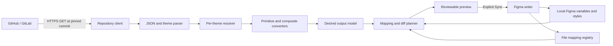

# Architecture

Blueprint is an independent, read-only Tokens Studio-compatible Figma plugin. It has two bundled entry points and no backend.

## Modules

| Module                    | Responsibility                                                                                                                                                                                    |
| ------------------------- | ------------------------------------------------------------------------------------------------------------------------------------------------------------------------------------------------- |
| `src/ui/`                 | Native-theme-aware interface, connection editing, network progress, collection browsing, export selection dialogs, conflicts and diagnostics                                                      |
| `src/providers/client.ts` | Shared safe HTTP transport with GitHub and GitLab endpoint adapters, custom API roots, commit pinning, tree traversal, pagination, four download workers, bounded caching and rate-limit cooldown |
| `src/core/parser.ts`      | Legacy/DTCG token leaves, nested paths, theme metadata, file/bundle detection, token set ordering and shape validation                                                                            |
| `src/core/resolver.ts`    | Theme-local source/enabled precedence, disabled-set exclusion, nested composite references, caching, cycle/depth detection                                                                        |
| `src/core/values.ts`      | Strict scalar types, sRGB conversion, px/rem conversion, dimensional arithmetic, context-specific metrics                                                                                         |
| `src/core/composites.ts`  | Typography, ordered effects, paints/gradient geometry, bindable source references and unsupported-property rejection                                                                              |
| `src/core/desired.ts`     | Mode-aware output, scalar decomposition, cross-collection aliases, shared vs theme-specific styles, deterministic names                                                                           |
| `src/sync/planner.ts`     | Current-file ID/key validation, registry matching, ambiguity and rename review, differential updates, dependency conflicts, preview totals                                                        |
| `src/figma/adapter.ts`    | Official async API discovery, font availability/loading, native creation, value/style binding writes, canonical snapshots                                                                         |
| `src/sync/engine.ts`      | Stale-preview checks, collection/mode allocation, variable allocation before aliases, dependency writes, style updates, result validation, cancellation and checkpoints                           |
| `src/figma/registry.ts`   | Versioned file registry, bounded shards, commit-head-last persistence                                                                                                                             |
| `src/plugin.ts`           | Typed model orchestration and UI request routing, credential/settings client storage, serial operation lock                                                                                       |

The iframe fetches and parses repository JSON. A `preview` message hands the parsed project and settings to the controller. The controller resolves/converts, reads local Figma objects asynchronously, checks fonts and builds the plan. Subsequent settings changes reuse the in-memory project. A `sync` message contains the preview ID, not an arbitrary operation list. The controller rejects stale IDs and document state changes. A new fetch never calls the writer.

## UI presentation

`src/ui/preview-model.ts` is the shared presentation boundary for the plugin controller and the
standalone demo. It serializes ordered modes, planned values and alias keys, style summaries,
operation states and diagnostics without exposing the raw project or document stamp. The UI
browses collections independently from the export group selection. Variables use a mode matrix;
styles use summaries with theme context; Review owns counts, conflicts and diagnostics.
The inline Changes/All filter includes new, updated and conflicting output in the current
collection without altering sync selection. Search opens on demand; Escape clears and closes
it and returns focus to the search button. Alias chips show target names, while row details
retain resolved values. Theme-aware row tints distinguish planned operations.
`src/ui/value-inspector.ts` owns the floating value card, reading ordered modes, alias targets
and resolved literals from the shared preview. It opens after hover intent or immediately on
keyboard focus/click, keeps interaction local, and dismisses on Escape, external focus/click,
table scrolling or rerender. The card is positioned inside the plugin bounds above the footer.
Lists render 60 rows at a time. Scroll, disclosures and keyboard focus are retained across
routine rerenders, and watch scheduling pauses while connection/settings are being edited.

## Identity and mapping

Lookup order: explicit designer choice → plugin registry → Tokens Studio ID/key hints → unique name within the expected collection/type. References are validated against objects actually present in the file. Unavailable hints, incompatible types, duplicate names and multiple source items targeting one object become conflicts. No remote library imports happen implicitly.

The public Tokens Studio `ThemeObject` documents string mapping fields. Its public `attachLocalVariablesToTheme` implementation writes `variable.key` into its variable reference map. Blueprint therefore accepts either local IDs or keys and does not assume all mappings use the same representation.

The registry stores repository identity (provider/API root/repository/path; branch deliberately excluded), source path/type/group/theme, target file identity, target ID, last synced values and status. Excluding branch lets branch switching update the same objects; revision is displayed separately. Changes to server/repository/path establish a different source identity. Descriptions are optional source metadata; code syntax, scopes, visibility and document-node bindings are never written.

The file identity uses `figma.fileKey` where available; otherwise it uses a plugin-owned document marker. Public plugins may not receive a file key. A copied document can copy that marker; local object/type/collection validation remains necessary. A known different file key invalidates copied mappings. IDs are never imported into another file blindly.

Potential renames without explicit metadata are suggestions only: a disappeared mapped item with matching group, type and values causes a reviewable conflict. A designer can retain the old target or explicitly create a new one. No heuristic automatically renames or deletes an object.

## Preservation and failure handling

- Existing variable and style IDs remain stable because changes use setters rather than remove/recreate.
- Descriptions remain local unless the designer disables preservation. Scopes, code syntax and visibility are always local.
- Local style bindings remain unless explicitly replaced. Incompatible local bindings block that style. A locally bound property can intentionally differ from the source literal; the preview discloses this.
- Source orphans and objects outside the current filters are listed and retained. Cleanup is manual in Figma; no deletion method exists in the writer.
- Figma has no transaction for this pipeline. Fonts are preflighted; state is checked before and after loading. Each item is validated after write. Style failures attempt to restore the previous style. Variable mode failures can leave partial values and are reported with a partial registry entry.
- Checkpoints occur after collections, during batches and in `finally`. Registry shards are written before a small head pointer is committed. Interrupted writes preserve the last committed registry. Unfinished new objects remain mapped for retry; they are never silently removed.
- Figma Undo checkpoints bracket the operation. Undo the sync immediately if an all-or-nothing rollback is required. Do not rely on atomic isolation from concurrent collaborators during a long sync.

## Performance

No scene-node scanning or loading all pages. Local variables, collections and styles are fetched once per snapshot. Resolution is memoized per theme. Conversion yields every 100 tokens; writes yield every 30 progress steps. Download concurrency is four. The change list renders 60 items at a time and filters client-side. Registry data is split into 18,000-character chunks (below the per-entry byte limit even for non-ASCII text).

Configured safety bounds: 2,000 JSON files, 5 MB per token file, 30 MB per response/repository content, 80 levels of token nesting, 100 levels of reference nesting, and 500 GitLab tree pages. The current file-size guard counts decoded JavaScript characters; it is a practical memory bound, not a byte-exact storage quota. Tree truncation or a limit fails the fetch rather than syncing an incomplete repository.

## Security boundary

Only provider GET endpoints are implemented. Tokens use request headers, never URLs. Redirects are refused; errors discard raw server bodies. Credentials and source content never leave for telemetry, proxies or unrelated services. Remembering a token is opt-in; otherwise it exists only in UI memory for the session. Settings and optional credentials use `clientStorage`; document registry data contains no credentials. Removing a connection deletes both saved config and credential.

The manifest allows arbitrary domains solely to support user-configured enterprise hosts. The transport constructs routes on the configured HTTPS API base; it does not follow URLs supplied by repository responses. For a private deployment, replace the wildcard with an explicit list of approved hosts. The UI bundles all assets and renders repository strings as escaped text.

Watch and automatic application were removed on 17 November 2026. Fetches are manual; native writes require export confirmation. The UI uses safe default settings with collection and output-type selection in a modal. Advanced settings retained in the engine are not exposed in this simplified interface.

## Verification boundary

Tests use Node’s built-in runner, a mocked HTTP transport, and an API-shaped Figma mock checked alongside official typings. They verify behavioural outcomes, including identity preservation, repeat runs, failures and 5,000-token operations. They cannot certify Figma hosting/CORS, real provider permissions, actual font metrics, rendering or plan entitlement. The release checklist covers those separately.

`src/ui/select-menu.ts` presents native select fields through a shared themed combobox and
listbox. It preserves native values and change events for connection, settings, conflict and
browsing handlers. Collection options add preview counts and semantic change indicators.
Keyboard navigation, typeahead, focus restoration, outside dismissal and viewport positioning
are handled in the component; rendering a new view clears any open menu.
