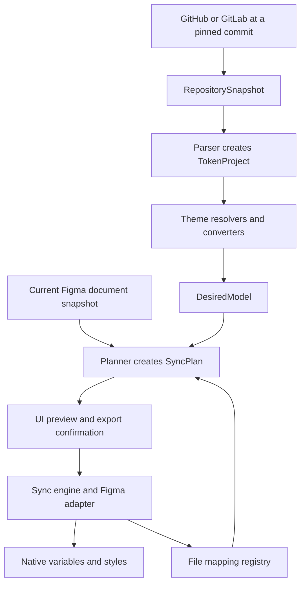

# Blueprint Token Sync developer guide

Blueprint · Token Sync is a Figma plugin that reads design tokens from GitHub or GitLab and turns them into native Figma variables, text styles, paint styles and effect styles. It gives designers a way to review and apply repository changes while keeping existing Figma objects and their bindings intact.

Repository access is read-only; an explicit **Send to Figma** action writes to the open design file. The plugin does not edit token JSON, push commits or sync Figma changes back to the repository. It is an independent implementation compatible with a documented subset of Tokens Studio formats, with no Tokens Studio platform connection or backend service.

This guide describes the implementation as of 20 November 2026. The package is version `0.1.0`, a development release. Start here for onboarding, then use the linked source files and specialist documents for implementation details.

## The problem it solves

Design tokens are named design decisions such as a brand colour, spacing value or text treatment. Repositories let teams version those decisions and consume them in application code. Designers also need those values in Figma, where variables and styles can be attached to designs.

Blueprint connects those two environments. It fetches a consistent repository snapshot, resolves token references and themes, compares the result with the current Figma file, and lets the designer apply the changes. Updating objects in place matters: replacing a variable or style with a new object can break the relationship with designs that already use it.

For example, a semantic token `color.action.background` can reference `{color.brand.primary}`. Blueprint converts the dot-separated name to `color/action/background` and preserves a native variable alias when an unambiguous, compatible exported target exists. If it cannot preserve that alias, it uses the resolved value and reports the reason. An alias across collections is supported when the source definition identifies a unique compatible target.

## What a designer can do

1. Connect a GitHub or GitLab repository, including a configured HTTPS enterprise host. Select a branch and token file or directory; the interface includes a remote branch picker.
2. Test the connection and fetch tokens. The fetch resolves a commit before downloading content so a moving branch cannot mix file revisions within one snapshot.
3. Browse variables by collection and mode, or switch to styles. Search, the Changes/All filter, expanded rows and the value inspector help explain proposed values and aliases.
4. Open **Send to Figma**, select the export scope and variable/style output, and review warnings or conflicts. Collection and theme selection determine the export; browsing and searching do not.
5. Confirm the write and inspect its result. The last result remains available for the session.

Sample tokens provide an onboarding path without repository credentials. In Figma, **Apply sample to this file** creates real variables and styles. The standalone browser preview uses an in-memory document and cannot perform native writes.

Fetch and apply are manual. There is no polling, automatic application, repository writeback or automatic deletion of objects whose source tokens have disappeared.

## How token data maps to Figma

The parser accepts legacy `type`/`value` tokens and supported Design Tokens Community Group (DTCG) `$type`/`$value` tokens. A repository can contain named JSON token sets with `$themes.json` and `$metadata.json`, or a single token file/bundle. The layout selector disambiguates bundles without metadata.

| Source concept                              | Figma behaviour                                                     |
| ------------------------------------------- | ------------------------------------------------------------------- |
| Theme group                                 | Variable collection                                                 |
| Theme within a group                        | Mode within that collection                                         |
| Ungrouped theme                             | Collection named after the theme                                    |
| No theme metadata                           | One collection per set with a Default mode                          |
| Colour, number/dimension, string or boolean | Compatible COLOR, FLOAT, STRING or BOOLEAN variable                 |
| Typography composite                        | Text style, using an available and loadable font                    |
| Shadow or supported blur                    | Effect style                                                        |
| Solid colour or supported gradient          | Paint style                                                         |
| Exact token reference                       | Native alias where a compatible exported variable can be identified |

Resolution happens separately for each theme. Sets marked `source` supply fallback definitions; `enabled` sets supply exported definitions and override source sets; `disabled` sets are excluded. Later enabled sets take precedence according to token set ordering. A source-only token can resolve a reference without being exported itself.

The converters validate units, colours, composite properties and native type compatibility. The default rem conversion uses 16 px. Missing references, cycles, incompatible types and unsupported properties produce diagnostics. Fonts are checked before writing rather than silently substituted. Some composites can be decomposed into scalar variables with a disclosure; not every token has a native Figma equivalent.

See [Compatibility and limits](COMPATIBILITY.md) for the exact conversion boundary, including gradient geometry, unsupported DTCG references and context-dependent units.

## How the plugin was built

The implementation uses strict TypeScript and the official Figma plugin typings. The interface is HTML, CSS and TypeScript with direct DOM rendering; it does not use React or another UI framework. Color.js handles colour parsing and conversion. esbuild produces two self-contained bundles, and Node's built-in test runner executes the automated tests.

The implementation separates token interpretation from Figma access. Parsing, resolution, conversion and planning can run against fixtures and document snapshots. The Figma adapter handles discovery, font loading and native writes. This makes the behaviour testable without opening Figma for every change.

The recorded development work began with compatibility research and module design, then added conversion, mapping, sync and audit safeguards. Interface refinement followed a Companion-inspired fetch/review/send workflow. Later changes simplified export dialogs and added branch selection, onboarding improvements and alias fixes. [Research and decisions](RESEARCH.md), [the audit implementation](AUDIT_IMPLEMENTATION.md), and Git history provide the background. Historical documents describe some features that have since been removed; the current source defines the behaviour.

### Two runtime environments

| Runtime              | Entry point                      | Responsibility                                                                                            |
| -------------------- | -------------------------------- | --------------------------------------------------------------------------------------------------------- |
| UI iframe            | `src/ui/app.ts` → `dist/ui.html` | Interface state, repository client orchestration, parsing, preview presentation and user actions          |
| Figma plugin sandbox | `src/plugin.ts` → `dist/code.js` | Provider HTTP bridge, client storage, Figma discovery, conversion/planning, font checks and native writes |

In Figma, the repository client runs in the iframe but sends HTTP requests through the `providerFetch` message. The sandbox validates the configured route and performs the GET request through `readProviderRoute`. It returns the response to the client for processing. The standalone preview uses a browser fetcher instead. Keep this distinction in mind when debugging network problems or reading earlier architecture notes.

The UI and sandbox communicate through messages with request IDs and success/error responses. The controller serializes its main operations. Cancellation, resizing and provider fetch messages have separate handling. The UI cannot submit an arbitrary write plan: a sync request identifies the plan held by the controller.

### Data flow



The main contracts live in [`src/core/model.ts`](../src/core/model.ts):

- `RepositorySnapshot` contains source identity, revision and downloaded files.
- `TokenProject` contains parsed sets, ordering, themes and diagnostics.
- `DesiredModel` describes the collections, variables and styles the source should produce.
- `DocumentState` represents the current local Figma objects.
- `SyncPlan` combines desired output, document state, mappings and operations classified as new, updated, unchanged, conflicting or skipped.
- `SyncReport` describes the outcome, including failures and partial progress.

Fetching never invokes the writer. A `preview` request builds desired output, snapshots Figma, checks fonts and plans changes. A later `sync` request must reference that preview's plan ID. The engine also checks document state before writing, so a preview is not permission to overwrite a subsequently changed file.

## Identity and preservation

Mapping is the core of repeatable sync. The planner checks explicit conflict choices, the plugin's file registry, Tokens Studio ID/key hints, and unique compatible names. It validates candidates against objects actually present in the file. Ambiguous matches and incompatible targets require resolution.

Source identity includes provider, API root, repository and token path. It deliberately excludes branch, allowing a branch switch to update the same mapped objects. Changing the repository or configured path creates a different source identity.

The writer updates existing objects through setters. It preserves IDs, scopes, code syntax, publishing visibility and node bindings; descriptions and local style bindings are preserved by default. Local divergence from the last synced state becomes a conflict. **Keep local** skips the relevant change in the current plan; it does not push anything to Git.

Objects removed from the source remain in Figma. Rename candidates are reviewed rather than silently inferred. Avoid adding deletion or remove-and-recreate behaviour when extending this pipeline.

Figma writes are not transactional. The engine allocates collections/modes and variables before assigning aliases, validates writes and saves registry checkpoints. Failures or cancellation can leave completed and partial work. The registry retains mappings for retry, and Undo checkpoints support immediate recovery. Do not treat a failed sync as an automatic rollback.

## Storage and network boundaries

`figma.clientStorage` holds connection settings, export settings and window dimensions. Remembering a credential is optional and off by default; otherwise the token stays in session memory. Remembered credentials are stored separately from public connection settings. Removing the connection deletes its saved credential. Client storage is not an encrypted secret vault.

The file registry is stored in plugin data on the document root. It records source/target identity, object mappings, last synced state and status, with versioned shards and a head pointer committed last. It contains no credentials. Repository downloads, parsed projects and active plans are not persisted as a repository mirror.

Provider requests use GET, HTTPS and authentication headers. Redirects are refused. The manifest permits arbitrary hosts to support configured enterprise servers; the transport validates routes against the configured API root. Assets are bundled locally, with no telemetry, third-party proxy or CDN dependency.

See [`src/providers/plugin-transport.ts`](../src/providers/plugin-transport.ts) for route validation and [`src/figma/registry.ts`](../src/figma/registry.ts) for registry persistence.

## Running the project locally

Use Node.js 18.18 or later, npm and Figma Desktop with development-plugin access. Run these commands from the repository root:

```sh
npm ci
npm run check
```

`check` runs formatting checks, strict typechecking, automated tests and the production build. In Figma Desktop, choose **Plugins → Development → Import plugin from manifest**, select `manifest.json`, then run **Blueprint · Token Sync**. The manifest points to `dist/code.js` and `dist/ui.html`.

The checked-in manifest has a development ID. If your Figma client requires an assigned ID, create a development plugin and use its ID. Keep that ID stable because client storage and plugin data are scoped to it.

| Command             | Use                                                                                                                    |
| ------------------- | ---------------------------------------------------------------------------------------------------------------------- |
| `npm run dev`       | Rebuild on source changes; reopen the Figma plugin to load the result                                                  |
| `npm run preview`   | Open the interface at `http://127.0.0.1:4174/?demo=1` for browser development                                          |
| `npm run typecheck` | Check TypeScript and Figma API typings                                                                                 |
| `npm test`          | Bundle and run the automated tests                                                                                     |
| `npm run build`     | Generate the self-contained plugin and UI bundles                                                                      |
| `npm run check`     | Run the full repository validation sequence                                                                            |
| `npm run package`   | Build and create `release/blueprint-token-sync.zip` with source, docs, fixtures and compiled output; requires Python 3 |

Make changes in `src/`, not generated `dist/` files. [`scripts/build.mjs`](../scripts/build.mjs) bundles the sandbox and inlines JavaScript/CSS into the UI HTML. The Figma iframe does not hot-reload. Browser preview is useful for layout and interactions, but native behaviour must be checked in Figma.

## Where to make changes

| Area                                       | Start here                                                            | Relevant coverage                                                         |
| ------------------------------------------ | --------------------------------------------------------------------- | ------------------------------------------------------------------------- |
| Provider access, branches, downloads       | `src/providers/client.ts`, `repository-url.ts`, `plugin-transport.ts` | `providers.test.ts`, `repository-url.test.ts`, `plugin-transport.test.ts` |
| Token formats and theme interpretation     | `src/core/parser.ts`, `resolver.ts`                                   | `core.test.ts`, fixture files                                             |
| Native values, composites and aliases      | `src/core/values.ts`, `composites.ts`, `desired.ts`                   | `core.test.ts`, `regressions.test.ts`                                     |
| Matching, local edits and change detection | `src/sync/planner.ts`, `changes.ts`                                   | `sync.test.ts`, `audit-regressions.test.ts`                               |
| Native writes and recovery                 | `src/sync/engine.ts`, `src/figma/adapter.ts`, `registry.ts`           | `sync.test.ts`, `controller.test.ts`, `mock-figma.ts`                     |
| Message routing and persisted settings     | `src/plugin.ts`                                                       | `controller.test.ts`                                                      |
| Interface and preview presentation         | `src/ui/app.ts`, `preview-model.ts`, `style.css`, UI helper modules   | `ui-interactions.test.ts`, `ui-preview.test.ts`, UI helper tests          |

Test paths in the table are relative to `tests/`. Sample inputs live in [`fixtures/`](../fixtures/README.md). For a new token conversion, follow the whole path from parsed input through desired output to native serialization; add a representative fixture or regression case that verifies the resulting behaviour. For sync changes, check repeat runs, local edits and recovery as well as the first successful write.

## Validation and release readiness

Automated coverage uses mocked provider responses and an API-shaped Figma mock, alongside compiled controller/UI tests. It exercises conversion, aliases, matching, preservation, failures and larger token sets. These checks cannot establish actual font rendering, provider permissions or behaviour on every Figma plan.

The recorded native sample pass verified creation, repeat-preview idempotency, partial-failure reporting and immediate Undo. Authenticated providers, enterprise endpoints, broader identity/binding preservation and several native UI/recovery cases still require live acceptance. Use [Release status](RELEASE_STATUS.md) for the evidence boundary and [Testing and acceptance](TESTING.md) for the checklist before production rollout. Historical test totals are snapshots; run the current suite for the current result.

For deeper implementation detail, continue with [Architecture](ARCHITECTURE.md), [Compatibility](COMPATIBILITY.md) and [GitLab setup](GITLAB_SETUP.md). Some older notes refer to the removed watch feature or iframe-only networking; use the runtime split above and current source when working on those areas.
